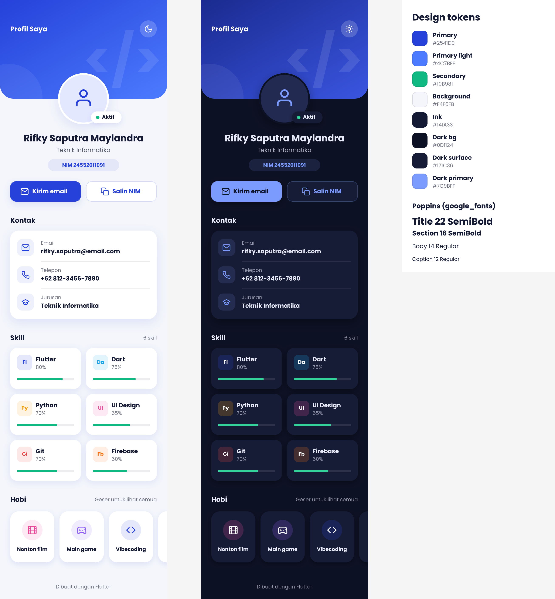

# Profil Mahasiswa — UTS Mobile II

Aplikasi profil pribadi mahasiswa (single page app) yang dibuat dengan **Flutter**.
Menampilkan foto, nama, NIM, jurusan, kontak, hobi, dan skill dengan tampilan
terang/gelap.

| | |
|---|---|
| **Nama** | Rifky Saputra Maylandra |
| **NIM** | 24552011091 |
| **Jurusan** | Teknik Informatika |



Desain dibuat terlebih dahulu di FigCraft: [`design/profil_mockup.figcraft`](design/profil_mockup.figcraft).

## Fitur

- Header gradien dengan foto profil dan badge status (Aktif / Cuti / Lulus)
- Tombol **Kirim email** (membuka aplikasi email) dan **Salin NIM** (menyalin ke clipboard)
- Kartu kontak: email, telepon, jurusan
- Grid skill dengan tingkat kemampuan (progress bar), diurutkan dari yang tertinggi
- Daftar hobi horizontal yang bisa digeser
- Mode terang/gelap lewat tombol di pojok kanan atas
- Responsif: konten dibatasi lebar 480 px di layar besar, grid skill menambah kolom di tablet

## Struktur proyek

```
lib/
├── main.dart                  # entry point, ThemeData global, toggle tema (setState)
├── models/profile.dart        # class Profile, Skill, Hobby + enum StatusMahasiswa
├── data/profile_data.dart     # data profil
├── cubit/profile_cubit.dart   # ProfileCubit (state management dengan flutter_bloc)
├── theme/app_theme.dart       # palet warna + tema terang/gelap (Poppins)
├── pages/profil_page.dart     # halaman utama profil
└── widgets/
    ├── profile_header.dart    # header (Stack) + avatar + badge status
    ├── info_card.dart         # InfoCard (Card + ListTile)
    ├── skill_item.dart        # SkillItem
    ├── hobby_item.dart        # HobbyItem
    ├── section_title.dart     # judul section
    └── action_buttons.dart    # tombol Kirim email & Salin NIM
```

## Pemenuhan ketentuan

| Ketentuan | Implementasi |
|---|---|
| Struktur folder `models/`, `widgets/`, `pages/` | ✅ lihat struktur di atas |
| Package eksternal | `google_fonts`, `flutter_bloc`, `url_launcher` |
| Class `Profile` + enum status | `models/profile.dart` (`StatusMahasiswa`) |
| Fungsi pengolah data & List | `inisial`, `rataRataSkill`, `skillTerurut()`, `copyWith()`; `List<Skill>`, `List<Hobby>` |
| Stack | `ProfileHeader` (gradien, avatar, badge) |
| Text, Image, Icon | nama/jurusan, `Image.asset` foto, ikon kontak & hobi |
| Row & Column, Container | di seluruh widget |
| Card / ListTile | `InfoCard` |
| ListView.builder | daftar hobi (horizontal) |
| GridView.builder | grid skill |
| Custom widget | `InfoCard`, `SkillItem`, `HobbyItem`, `SectionTitle`, `ActionButtons`, `ProfileHeader` |
| ThemeData global + palet konsisten + font custom | `theme/app_theme.dart`, Poppins via `google_fonts` |
| StatefulWidget | `MyApp`, `ProfilPage` |
| *(Bonus)* `setState()` mode terang/gelap | `main.dart` |
| *(Bonus)* Cubit/Bloc | `ProfileCubit` — ketuk badge status untuk mengganti status |

## Palet warna

| Token | Terang | Gelap |
|---|---|---|
| Primary | `#2541D9` | `#7C9BFF` |
| Secondary | `#10B981` | `#34D399` |
| Background | `#F4F6FB` | `#0D1124` |
| Surface | `#FFFFFF` | `#171C36` |
| Teks | `#141A33` | `#E8EBFA` |

## Menjalankan

```bash
flutter pub get
flutter run            # pilih device (HP Android, Chrome, dll)
flutter test           # menjalankan widget test
```

Untuk mengganti foto, letakkan file di `assets/images/` lalu ubah path di
`lib/widgets/profile_header.dart`.
